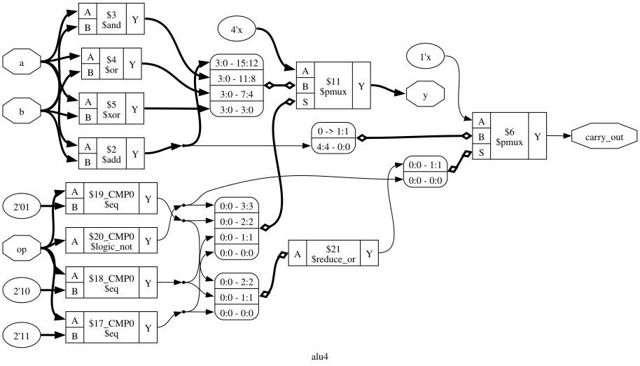

# alu4

A 4-bit ALU taken from RTL to GDS with OpenROAD and KLayout on the Nangate45 (FreePDK45) standard-cell library.

| `op` | Operation | `carry_out` |
|------|-----------|-------------|
| `00` | `a + b`   | carry bit   |
| `01` | `a & b`   | 0           |
| `10` | `a \| b`  | 0           |
| `11` | `a ^ b`   | 0           |



## Dependencies

- [OpenROAD-flow-scripts (ORFS)](https://github.com/The-OpenROAD-Project/OpenROAD-flow-scripts). It provides the
  `openroad` binary, the Nangate45 platform and the KLayout helper scripts. The standard-cell library is **not**
  included in this repo.
- KLayout, Python 3
- Icarus Verilog (simulation)
- Yosys (synthesis)

### Files used from ORFS

From `flow/platforms/nangate45/`:

- `lef/NangateOpenCellLibrary.tech.lef`, `lef/NangateOpenCellLibrary.macro.lef`
- `lib/NangateOpenCellLibrary_typical.lib`
- `gds/NangateOpenCellLibrary.gds`
- `rcx_patterns.rules`
- `FreePDK45.lyt`, `drc/FreePDK45.lydrc`

From `flow/util/`: `generate_klayout_tech.py`, `def2stream.py`

### Pointing the flow at ORFS

The flow expects ORFS at `/OpenROAD-flow-scripts` (its location in the ORFS Docker image). To use another location, pass
`FLOW_HOME` to `make`; `PLATFORM` is derived from it:

```bash
make FLOW_HOME=/path/to/OpenROAD-flow-scripts/flow
```

When running a script directly, export them yourself: the `.sh` scripts read `FLOW_HOME`, the `.tcl` scripts read
`PLATFORM`.

## Layout

```
Makefile              Runs the flow, stage by stage or end to end
rtl/alu4.v            RTL
tb/alu4_tb.v          Testbench
scripts/synth.tcl     Yosys synthesis to Nangate45 cells
scripts/*.tcl         OpenROAD flow steps
scripts/*.sh          GDS generation and DRC (KLayout)
docs/                 Schematic diagram
```

## Running the flow

```bash
make            # full flow: RTL -> GDS, DRC and post-route timing
make help       # list stages
make <stage>    # run up to and including one stage
make clean      # remove all generated files
```

Make only reruns a stage when its inputs or script changed. Override tools with `YOSYS=`, `OPENROAD=`, `IVERILOG=`
or `VVP=` if they aren't on your `PATH`.

| Stage | Script | Writes |
|-------|--------|--------|
| `sim` | Icarus Verilog | `build/alu4_tb.out` |
| `synth` | `scripts/synth.tcl` | `alu4_mapped.v` |
| `timing` | `scripts/timing.tcl` | pre-layout timing report (stdout) |
| `floorplan` | `scripts/floorplan.tcl` | `alu4_floorplan.odb`, `alu4_floorplan.def` |
| `pdn` | `scripts/pdn.tcl` | `alu4_powered.odb` |
| `global_route` | `scripts/routing.tcl` | `alu4_global_route.odb`, `alu4_route.guide` |
| `detailed_route` | `scripts/detailed_route.tcl` | `alu4_routed.odb`, `alu4_routed.def`, `alu4_drc.rpt` |
| `sta` | `scripts/post_route_sta.tcl` | `alu4_routed.spef` |
| `gds` | `scripts/generate_gds.sh` | `alu4.gds` |
| `drc` | `scripts/run_drc.sh` | `alu4_drc.lyrdb` |

All generated files are ignored by git.
